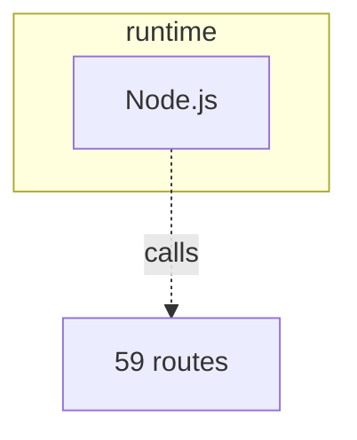

# Containers and layers

C4 level 2: the deployable pieces, as layers from the user down to the data. Each box names its technology; a box with no technology is a gap to fill.

| Layer | Tech | Where | Source |
|---|---|---|---|
| runtime | Node.js | @protoboxai/codeloop | source: package.json |
| package manager | npm | - | source: lockfile |
| test framework | vitest | - | source: package.json dependencies |
