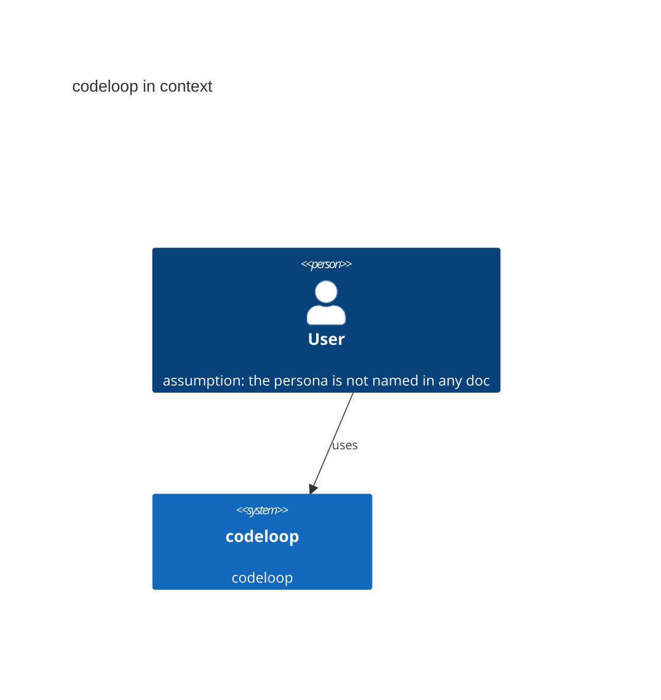

# System context

C4 level 1: the system as one box, the people who use it and the systems it talks to.

| Who or what | Role | Source |
|---|---|---|
| User | assumption: the persona is inferred, not stated | - |
| (no external systems found) | assumption: no deploy config names one | - |
