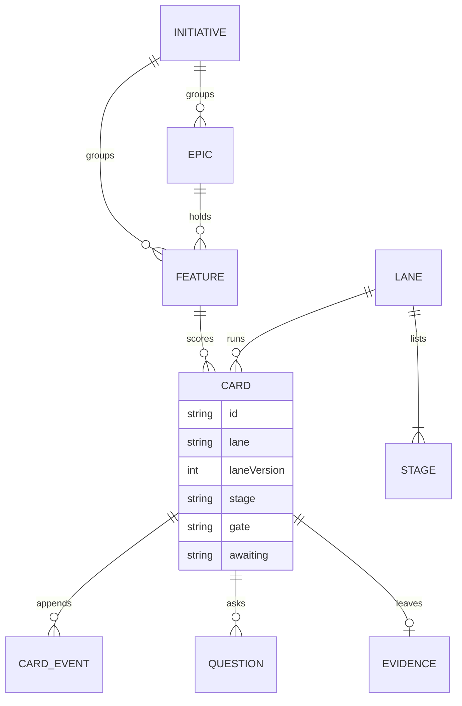

# Data model

Everything is a file under `.codeloop/`, `specs/`, `evidence/` or `docs/`. The cards file is the only one the engine writes with a version counter; the rest are markdown or YAML read through the store.

| Entity | Where it lives | Field that matters | Why |
|---|---|---|---|
| Card | `.codeloop/cards.json` | `laneVersion` | A card finishes on the lane version it started on; `lane promote` bumps the version without moving cards |
| Card | `.codeloop/cards.json` | `gate`, `awaiting` | Set together when parked; `gate: stuck` means retries ran out and the owner must unstick |
| Card | `.codeloop/cards.json` | `retries`, `failures` | Per-stage failure count and the fingerprint of the work at the last failure |
| Card | `.codeloop/cards.json` | `summary` | What the story needs and what is done, one line each with who wrote it, person or agent, the step and the time; an agent write never replaces a person's line, and "what you must do" is worked out from the board on each read (c-311) |
| Card | `.codeloop/cards.json` | `stage` | `done`, `proposed`, `dropped` and `queued` are not lane stages and hold no wip slot (`inLane` in `src/lib/cards.ts`) |
| CardEvent | `card.events` | `fingerprint` | On an approval: hash of the output and check, so a later change re-parks the card |
| CardEvent | `card.events` | `agent`, `exit`, `log` | `agent-start` and `agent-run` pairs; `max_runs_per_day` is counted from these |
| Lane | `.codeloop/lanes/*.yaml` | `retries`, `wip`, `on_done` | Stuck threshold, concurrent cards, follow-on lane or story queue |
| Stage | lane file | `done.cmd`, `gate` | The check whose exit code decides, and who must approve (owner or reviewer) |
| Feature | `.codeloop/wiki/features/` | `rice` | Reach, impact and confidence 1 to 10 and effort in weeks; the inbox orders by this score |
| Question | `specs/` per card | `recommended`, `answer` | The interview stage is done when every question has an answer |
| ReviewPass | `.codeloop/state/review-pass.json` | `at` | The orchestrator's review pass reads only stories changed since `at`; it moves only when a pass completes (c-307) |

## Sharp edges

- `.codeloop/cards.json` is one file, so every write rewrites the whole board and each reader holds it in memory; the project index in `src/lib/index/index.ts` exists so the board does not re-parse it per request (bench: 5k cards, list under 5 ms, commit b571fd7).
- A number can be shared by two prefixes (CL-001 and c-001); folders are then keyed by the lowercased id (`cardKey` in `src/lib/cards.ts`, test: get separate spec, use-case and evidence folders in `src/lib/__tests__/review.test.ts`).
- The store README plans to move cards onto a driver last, because `writeCards` also writes the cloud board (`src/lib/store/README.md`).
