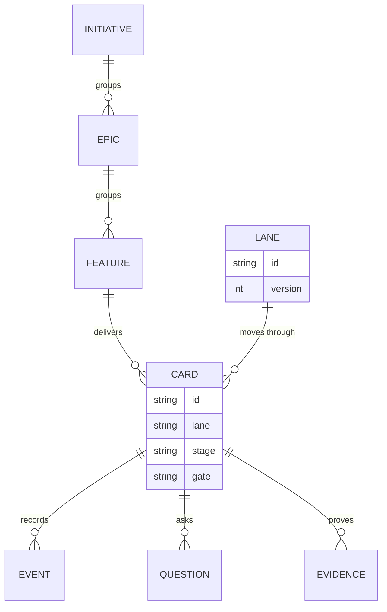

# Data model

Cards live in `.codeloop/cards.json`; the other entities are files under `.codeloop/` read through the store in `src/lib/store/schema.ts`.

| Entity | Field that matters | Why |
|---|---|---|
| Card | `stage` | Where the card is; `done`, `proposed`, `dropped` and `queued` are not lane stages. |
| Card | `laneVersion` | A card keeps the lane version it started on, so promoting a lane does not move it. |
| Card | `events` | The only history; every move, approval and agent start is appended. |
| Card | `retries` | Per-stage failures, read to decide `stuck`. |
| Lane | `stages[].done.cmd` | The shell check whose exit code moves a card. |
| Lane | `stages[].gate` | Names the approver (owner or reviewer) and whether the stage is outward. |
| Event | `agent-start` | Counted for `max_runs_per_day` and to stop two runs on one stage. |
| Question | answer | A parked card waits on it before the agent continues. |
| Evidence | kind | Output files a use case produced, shown on the card. |
