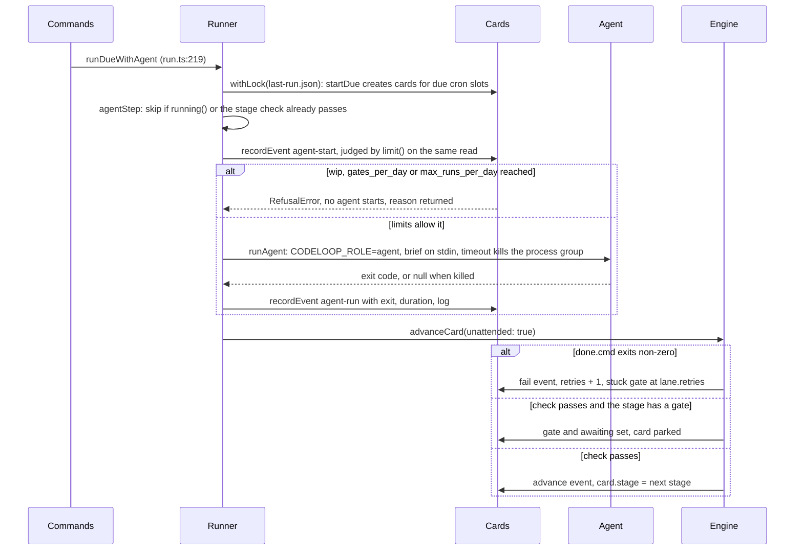
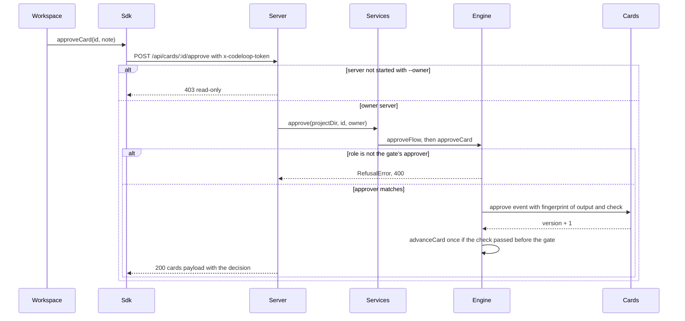
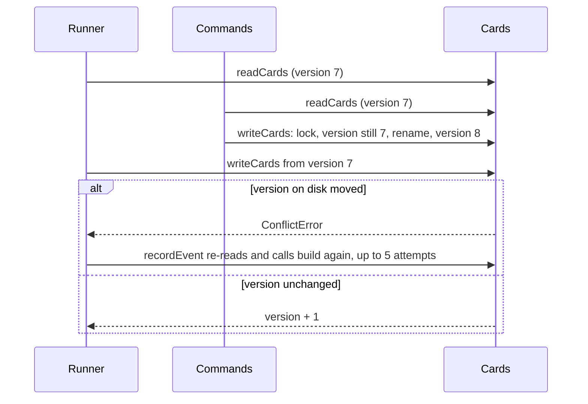

# Flows

## An unattended run works one stage

`codeloop run --agent` (cron or by hand). The Runner starts an Agent only when the stage's check fails, then calls the Engine, which alone moves the card.

## The owner approves a gate on the board

The board is read-only unless `codeloop serve --owner` started it. Approving also advances once when the stage's check had already passed.

## Two processes write the board at once

A cron run and a person at a terminal both call `writeCards`. The loser retries from a fresh read.

## Sharp edges

- `advanceCard` runs the stage check outside the lock. If the check wrote the board itself (the scan stage proposes cards), the advance is written on that newer board; if a person moved or parked the card meanwhile it throws `ConflictError` instead (`src/lib/engine.ts:450`).
- A failing check with an unchanged output file counts no retry on an unattended run, so a stage cannot reach stuck by being polled (test: does not count a failure again while the working tree is unchanged, in `src/lib/__tests__/review.test.ts`).
- Nothing the Runner starts can approve its own gate: `resolveRole` refuses any role but agent when `CODELOOP_AGENT_RUN` is set (test: runs the agent as CODELOOP_ROLE=agent, in `src/lib/__tests__/agent.test.ts`).
- Lane `done.cmd` lines need `codeloop` on PATH; call sites must pass `checkEnv()` (`.codeloop/wiki/gotchas/lane-checks-need-codeloop-on-path.md`).
