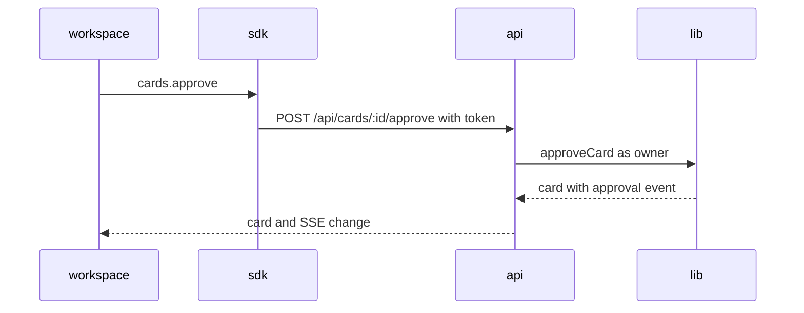
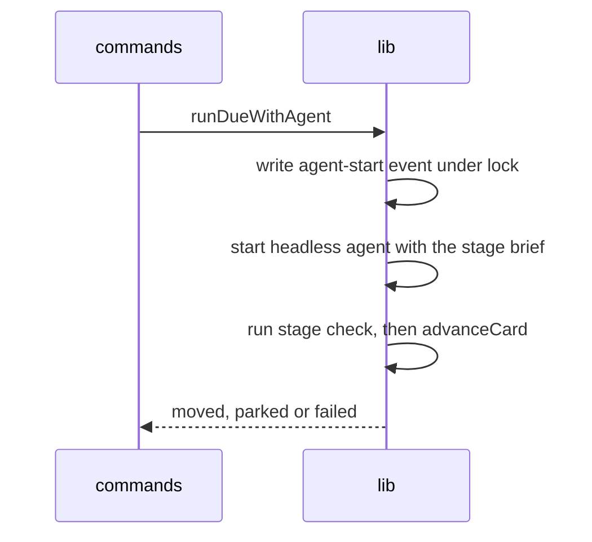
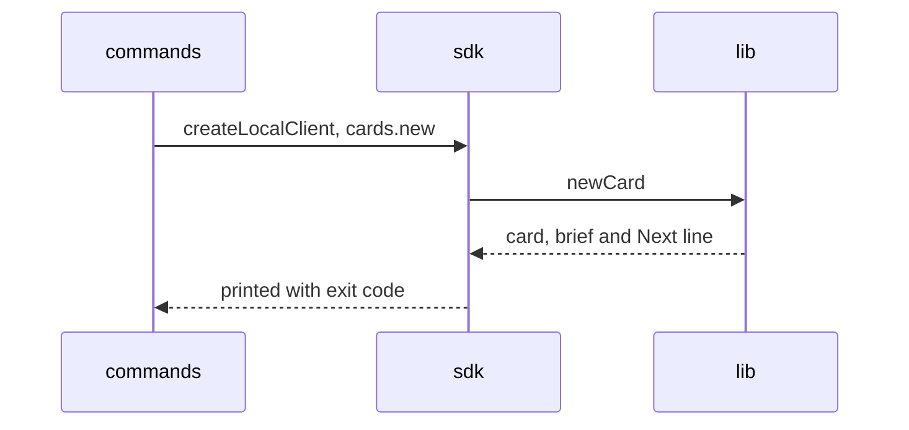
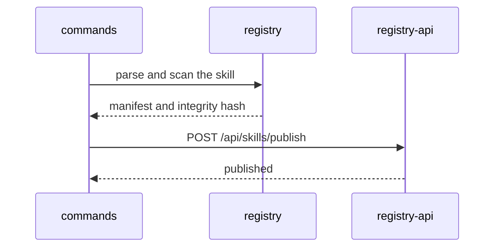

# Flows

Participant names are the folders in the overview table.

## Owner approves a gate from the board

## A scheduled run works one card

## The CLI creates a card without a server

## A skill is published

