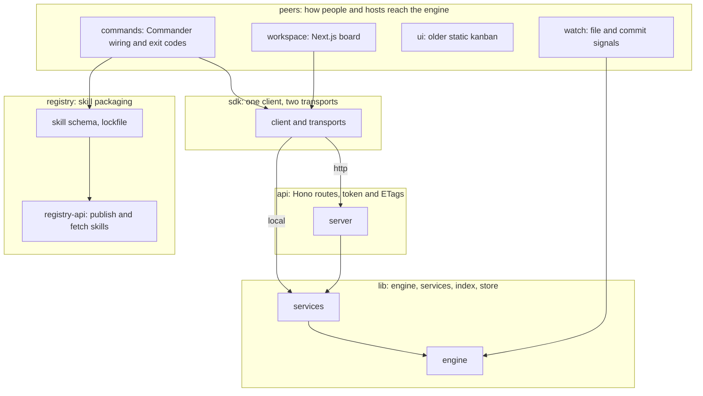

# Overview

codeloop is a CLI and local board that runs AI coding agents through lanes: ordered stages, each with a shell check that must exit 0, and optional gates where a named person approves. The CLI, a Next.js board and an MCP server all drive one engine that stores cards in `.codeloop/cards.json`. Agents do the work in a stage; the engine alone decides whether a card moves. A separate small service publishes skills to a registry.

| Folder | Purpose | Depends on |
|---|---|---|
| `src/lib` | The engine: cards, lanes, gates, agent runs, wiki, the project index and store drivers; `src/lib/services.ts` is the one surface callers use. | none above it |
| `src/commands` | One Commander file per CLI command; prints, sets exit codes. Most call the SDK; engine-internal ones are listed in `src/__tests__/layering.test.ts`. | `src/sdk`, `src/lib` |
| `src/sdk` | `CodeloopClient` over an http or a local transport, plus the types every caller shares. | `src/lib` (local only) |
| `src/registry` | Parses, scans and locks skill packages for `codeloop install` and `publish`. | none |
| `src/watch` | `codeloop watch`: turns file changes, commits and idle time into warnings. | `src/lib` |
| `src/__tests__` | Cross-layer tests: the import rule between commands and lib, and every `--help`. | `src/commands` |
| `workspace` | The board the owner opens: inbox, cards, roadmap, wiki, stats. Static-built, served by `codeloop serve`. | `src/sdk` over http |
| `ui` | The first kanban board, still served when `--ui` or `dist/ui` is given. | the API |
| `registry-api` | Next.js routes and a Postgres schema behind the skill registry. | none |
| `scripts` | End-to-end proofs, the demo week, and the workspace build for the package. | `dist/` |
| `site` | The docs and marketing site, generated command pages included. | none |

Differences from the README: none found.
