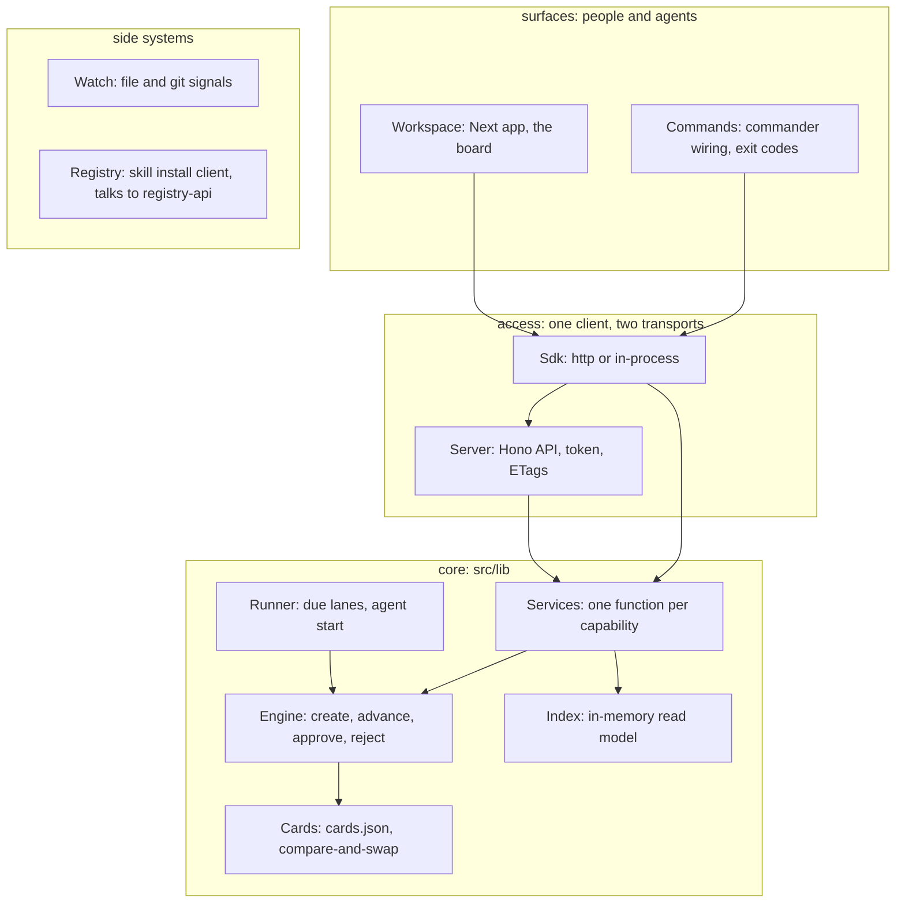

# Overview

codeloop is a CLI and local board that moves work cards through lanes. A lane is a YAML list of stages; each stage names a skill, an output file and a `done.cmd`. The engine advances a card only when that command exits 0, parks it at a gate for a named approver (owner, reviewer or agent), and appends every action to the card's events. `codeloop run --agent` starts a headless agent per stage, but the engine, not the agent, decides whether the stage passed. The README says "a lane engine with a board"; the code agrees, and the knowledge files from `docs/how-it-works.md` (gotchas, rules) now live in the wiki under `.codeloop/wiki/`.

| Name | Folder | Purpose | Depends on |
|---|---|---|---|
| Entry | `src` | `src/index.ts` parses the tree `src/program.ts` builds | Commands |
| Commands | `src/commands` | One file per subcommand: arguments, printing, exit codes | Sdk, Engine (exempt files only) |
| Core | `src/lib` | Services, Server, Engine, Runner (starts the headless Agent), Cards, Index, lanes, wiki, store | itself |
| Sdk | `src/sdk` | `CodeloopClient` over an http or in-process transport | Server, Services |
| Tests | `src/__tests__` | `src/__tests__/layering.test.ts` and `src/__tests__/help.test.ts`, the two rules that span folders | Commands |
| Watch | `src/watch` | Turns file, commit and idle signals into trigger events | Core |
| Registry | `src/registry` | Installs skills; `src/registry/security.ts` blocks eval-like patterns | Registry API |
| Workspace | `workspace` | The board app, served inside `codeloop serve` on one port | Sdk |
| Ui | `ui` | Static kanban from the first release; served only if no workspace build exists | Server |
| Registry API | `registry-api` | Skill registry: three routes over Postgres | none in this repo |
| Scripts | `scripts` | Build packaging, e2e proofs, benchmarks | built CLI |
| Site | `site` | Docs and marketing site; `site/scripts/gen-commands.mjs` builds the command reference | none |

Left out: `src/__tests__/integration` (two older board tests, no architecture of their own).

## Sharp edges

- `src/commands/*` may not import `src/lib` except the files listed in `src/__tests__/layering.test.ts`; most command files are on that list with a reason, so the rule covers only the migrated ones (from `docs/architecture.md`).
- `src/index.ts` registers `skillCommand` itself rather than in `src/program.ts`, so `src/lib/architecture-check.ts` keeps a literal subcommand list that must be edited by hand when a command is added (source: comment above `CODELOOP_SUBCOMMANDS`).
- `ui/` is built by `npm run build:ui` into `dist/ui` and is never used when `dist/workspace` exists (`src/commands/serve.ts:119`).
